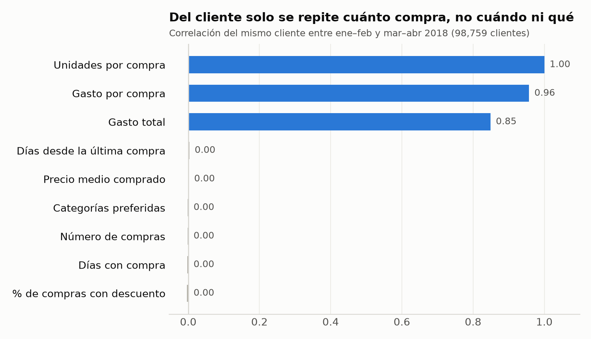
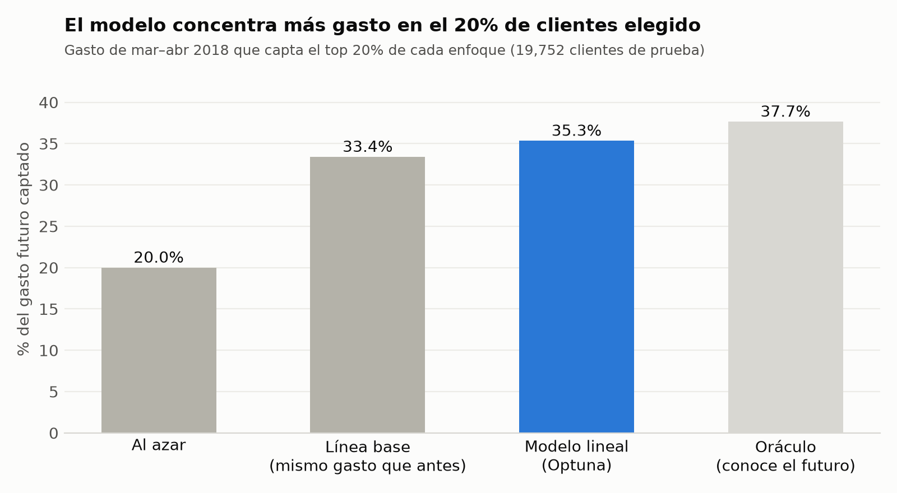

# Valor futuro de los clientes · Proyecto Final ML for Business

[](https://github.com/MrCifristo/valor-clientes/actions/workflows/ci.yml)

**Reto 3 · Comportamiento de compra de los clientes** — Machine Learning for Business, UFM 2026.
George Albadr · Gian Paolo · Milton Beltrán.

> **Pregunta de negocio:** ¿A qué clientes debe dirigir Marketing su próxima campaña, según cuánto van a comprar en los próximos meses?

| Elemento | Definición |
|---|---|
| Contexto | Cadena de supermercados con 98,759 clientes en 96 ciudades de un país; 6.7 millones de líneas de venta entre enero y mayo de 2018. |
| Stakeholder | Gerencia de Marketing: decide a quién destina el presupuesto de la próxima campaña. |
| Objetivo analítico | Regresión del valor futuro de cada cliente: con su comportamiento de ene–feb, predecir su gasto de mar–abr; luego ordenar y segmentar por valor predicho. |
| Métrica de éxito | Técnica: error del gasto predicho (MAE/RMSE) contra la línea base. Negocio: % del gasto futuro que capta el 20% de clientes elegido por el modelo. |
| Por qué no una segmentación clásica | Los hábitos (frecuencia, recencia, categorías, región) se comportan como azar: los segmentos K-Means por hábitos no se repiten entre periodos (ARI 0.00) y los RFM tampoco (0.10). Solo el valor es estable (ARI 0.78). Ver [`notebooks/01_exploracion.ipynb`](notebooks/01_exploracion.ipynb). |

## Hallazgos de la exploración



- **Cada cliente compra siempre la misma cantidad** por línea (99.98% de los clientes): es el rasgo que define su valor.
- **La frecuencia de compra es azar:** índice de dispersión 0.99 (Poisson puro = 1) y correlación ~0 entre periodos.
- **Sin diferencias regionales:** gasto por cliente igual en las 96 ciudades (prueba F, p = 0.83).
- **Sin patrones de hora, día ni descuento:** 24 horas parejas, ingreso diario con 0.55% de variación, mismas unidades con o sin descuento.

Detalle y decisiones en [`docs/decisiones.md`](docs/decisiones.md).

## Resultados del modelo



Sobre 19,752 clientes de prueba que no se usaron para entrenar ni para ajustar hiperparámetros:

| Enfoque | MAE | RMSE | R² | Gasto futuro que capta el top 20% |
|---|---|---|---|---|
| Al azar | — | — | — | 20.0% |
| Línea base (mismo gasto que en ene–feb) | 4,691 | 6,738 | 0.70 | 33.4% |
| **Modelo lineal (ElasticNet + Optuna)** | **3,273** | **4,688** | **0.85** | **35.3%** |
| Gradient boosting (HistGB + Optuna) | 3,272 | 4,688 | 0.85 | 35.3% |
| Oráculo (conoce el futuro) | 0 | 0 | 1.00 | 37.7% |

- **Modelo elegido: lineal.** El gradient boosting con Optuna empata (RMSE de CV 4,763 vs. 4,761); por la regla de selección se queda el modelo más simple, que es más fácil de explicar e implementar.
- **Mejora sobre la línea base:** +1.9 puntos del gasto futuro dentro de la campaña (IC 95% bootstrap: +1.8 a +2.1), unos **39 millones** de gasto de mar–abr adicional cubierto (extrapolado a toda la base desde el conjunto de prueba). El modelo cierra el 87% de la brecha entre elegir al azar y el oráculo.
- **Una sola variable explica casi todo:** las unidades por compra. El resto del gasto es azar (frecuencia Poisson y precios al azar) y ningún modelo lo puede predecir.
- **Lista de campaña:** `data/07_model_output/lista_campana.csv` ordena a los 98,759 clientes por gasto predicho para may–jun (con su comportamiento de mar–abr) y marca el 20% a contactar.

## Instalación

Requiere Python 3.10 o superior.

```bash
git clone https://github.com/MrCifristo/valor-clientes.git
cd valor-clientes
python -m venv .venv && source .venv/bin/activate
pip install -e ".[dev,notebooks]"
```

## Datos

El dataset completo (7 CSV, ~520 MB) no cabe en GitHub. Hay dos formas de correr el proyecto:

| Opción | Comando | Datos |
|---|---|---|
| Muestra (rápida, la usa CI) | `kedro run --env muestra` | `data/01_raw/muestra/`: 2,000 clientes al azar con todas sus compras, versionada en el repo |
| Completo | `bash scripts/descargar_datos.sh` y luego `kedro run` | Descarga los CSV del [Release `datos-v1`](https://github.com/MrCifristo/valor-clientes/releases/tag/datos-v1) a `data/01_raw/` |

La muestra se regenera desde el dataset completo con `python scripts/crear_muestra.py`.
Diagrama entidad-relación: [`docs/erd.png`](docs/erd.png).

## Ejecución

```bash
kedro run                        # pipeline completo (3 a 8 min con el dataset completo, según la máquina)
kedro run --env muestra          # con la muestra
kedro run --pipeline exploracion # un solo pipeline
pytest                           # pruebas
ruff check . && ruff format --check .
```

## Pipelines

| Pipeline | Nodos | Salidas principales |
|---|---|---|
| `carga_limpieza` | `generar_reporte_calidad`, `limpiar_ventas`, `construir_ventas_primarias` | `reporte_calidad_datos.json`, `ventas_primarias.parquet` (con el ingreso recalculado) |
| `transformacion` | `construir_tabla_modelo` | `tabla_modelo.parquet`: un cliente por fila, variables de ene–feb y objetivo de mar–abr |
| `exploracion` | `medir_estabilidad`, `evaluar_segmentacion`, `perfilar_regiones`, `perfilar_tiempo` y 3 gráficas | JSON y PNG en `data/08_reporting/` |
| `entrenamiento` | `dividir_clientes`, `optimizar_lineal`, `optimizar_gradient_boosting`, `seleccionar_modelo` | Modelos en `data/06_models/`, `intentos_optuna.csv` |
| `evaluacion` | `predecir_prueba`, `calcular_metricas`, `explicar_modelo`, `auditar_ciudades`, `puntuar_clientes` y 2 gráficas | `metricas_modelo.json`, `importancia_variables.json`, `auditoria_ciudades.csv`, `lista_campana.csv` |

Parámetros en `conf/base/parameters_*.yml` (ventanas de tiempo, limpieza, segmentación) y datos en `conf/base/catalog.yml`.

## Estructura

```
conf/base/           catálogo y parámetros
conf/muestra/        catálogo que apunta a la muestra (CI)
data/01_raw/muestra/ muestra versionada
docs/                decisiones, plan de trabajo, figuras, ERD
notebooks/           exploración (con resultados guardados)
scripts/             descarga del dataset y creación de la muestra
src/valor_clientes/  pipelines y nodos
tests/               pruebas con pytest
```

## Integración continua

`.github/workflows/ci.yml` corre en cada push y pull request: instala dependencias, Ruff (lint y formato), pytest, `kedro run --env muestra` y verifica que existan las salidas.

## Fuentes

Dataset de ventas de supermercado compartido por el curso (7 tablas, enero a mayo de 2018). Herramientas: Kedro, pandas, scikit-learn, SciPy y matplotlib.
